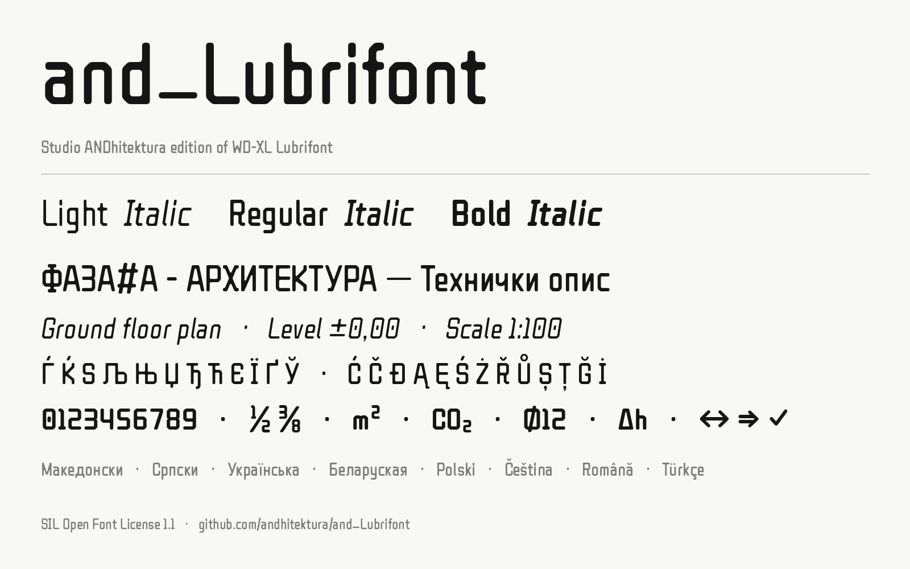

# and_Lubrifont



**and_Lubrifont** is Studio ANDhitektura's edition of [WD-XL Lubrifont](https://github.com/NightFurySL2001/WD-XL-font) by NightFurySL2001, itself based on [ZCOOL QingKe HuangYou](https://www.github.com/googlefonts/zcool-qingke-huangyou). It keeps the original's geometric, rounded-square design and its full Chinese and Japanese character set, and extends it for architectural and technical documents in Macedonian and other European languages.

The font is free and open source under the [SIL Open Font License 1.1](./OFL.txt).

## What this edition adds

Compared with the original WD-XL Lubrifont (v2.100):

- **Languages:** Macedonian, Serbian, Croatian, Bosnian, Slovenian, Ukrainian, Belarusian, Polish, Czech, Slovak, Romanian and Turkish
- **Legibility:** letters that can't be confused in drawings and tables: a zero with a centre dot (`0` vs `O`), a 7 with a diagonal stem, an `l` with a foot and `i j` with a tall dot (`l` vs `I` vs `1`), a longer arm on the `r` (`rn` vs `m`), and a diagonal bar on `ł Ł`
- **Spacing:** corrected and evened-out letter spacing, slightly more open overall, and kerning for Latin, Cyrillic and punctuation
- **Accents:** combining stress accents (`е́ о́ и́`) sit correctly on Cyrillic letters, and accented capitals are no longer clipped at the top
- **Numbers and symbols:** tabular figures, fractions, superscripts and subscripts, and the symbols of technical drawings: `⌀ ∅ ∆ ⋅ ∡ ≅`, arrows, plan and electrical symbols, checkboxes, `⚠ ♿ ℓ` and the GD&T tolerance symbols, with all math signs at one width
- **A light Latin / Cyrillic / Greek edition:** about 300 KB instead of 6–12 MB, in three weights, **Light**, Regular and **Bold**, each with an *italic*
- **Screen and web:** hinted `.ttf` for sharp text at small sizes, and WOFF2 web fonts
- **Quality:** every change is checked automatically with [fontbakery](https://github.com/fonttools/fontbakery)

See [Updates](./UPDATES.md) for the full list.

## Download

Download the latest version from the **[Releases page](https://github.com/andhitektura/and_Lubrifont/releases)**, or take the files from the [`fonts`](./fonts) folder. There are two downloads:

**`and_Lubrifont`: the one you need** for Macedonian, English and other European languages. Six files, three weights with their italics:

| File | Appears in font menus as |
| --- | --- |
| `andLubrifont-Regular.ttf` | **and_Lubrifont** |
| `andLubrifont-Italic.ttf` | and_Lubrifont, style Italic (the *I* button) |
| `andLubrifont-Bold.ttf` | and_Lubrifont, style Bold (the **B** button) |
| `andLubrifont-BoldItalic.ttf` | and_Lubrifont, style Bold Italic |
| `andLubrifont-Light.ttf` | **and_Lubrifont Light** |
| `andLubrifont-LightItalic.ttf` | and_Lubrifont Light, style Italic |

Install all six. The **Bold** and *Italic* are linked to the Regular: when you switch text to bold or italic, the application uses the real Bold or Italic instead of thickening or slanting the letters itself, which distorts them. The **Light** appears as its own entry, because Windows menus only group Regular, Bold and their italics under one name.

The italic is slanted at 9° and keeps the upright letter shapes, in Latin as well as Cyrillic, in keeping with the font's geometric, technical character.

The `otf` subfolder has the same six fonts in OpenType-CFF format. They look identical; install either the `.ttf` or the `.otf` files, not both. The `.ttf` is the safe choice: it works everywhere, including technical applications that accept only TrueType fonts, and it is hinted for sharp text on screen. The `woff2` folder is for websites (see [Web fonts](#web-fonts)), not for installing.

**`and_Lubrifont-CJK`: only if you also write Chinese or Japanese.** The same Latin, Cyrillic and Greek letters, plus about 18,000 Chinese and Japanese characters (6–12 MB per file, Regular weight only). Install the one version that matches your text:

| File | Appears as | For |
| --- | --- | --- |
| `andLubrifontSC-Regular.ttf` | and_Lubrifont SC | Simplified Chinese (mainland China) |
| `andLubrifontTC-Regular.ttf` | and_Lubrifont TC | Traditional Chinese (Taiwan, Hong Kong) |
| `andLubrifontJPS-Regular.ttf` | and_Lubrifont JP S | Japanese, JIS90 character forms |
| `andLubrifontJPN-Regular.ttf` | and_Lubrifont JP N | Japanese, JIS2004 character forms |
| `andLubrifont.ttc` | all four of the above | all four in one smaller file |

The `otf` subfolder of the download has the same four fonts in OpenType-CFF format (also in [`fonts/and_Lubrifont-CJK/otf`](./fonts/and_Lubrifont-CJK/otf)); the `.ttc` contains those four in one file and installs directly on Windows and macOS. Install only one of the `.ttf`, `.otf` or `.ttc` versions.

The regional codes (SC, TC, JP) exist because Chinese and Japanese draw some of the same characters differently.

**Versions.** The version number (e.g. 2.602) only tells you which release you have; there is always just one current version. Install the newest one and uninstall the older one first.

### Installing on Windows

1. Uninstall any older **WD-XL Lubrifont** or **and_Lubrifont** fonts first. Otherwise both stay in your font menus.
2. Right-click the font file and choose **Install for all users**.
3. Restart the application.

### Installing on macOS and Linux

- **macOS:** double-click each font file and click **Install Font** (Font Book), or select all six in Font Book.
- **Linux:** copy the font files to `~/.local/share/fonts` (or `/usr/local/share/fonts` for all users) and run `fc-cache -f`.

Documents that used "WD-XL Lubrifont SC" need the font reassigned to "and_Lubrifont" (or "and_Lubrifont SC").

## Using the font in your software

The letters, spacing and accents work in every application. **Kerning** (the adjusted spacing of pairs such as `AV`, `Ту`) is applied automatically by most applications and browsers; a few word processors apply it only after it is switched on in the font or character settings, and some technical text engines do not apply it at all.

**Tabular figures, fractions, superscripts and subscripts** are OpenType features: switch them on in the application's OpenType or typography settings, or in CSS with `font-feature-settings`. Where an application has no such settings, type the ready-made characters directly (`½ ⅜ ² ₂`).

See [OpenType features](./FEATURES.md) for every feature and how to switch it on.

## Character set

**Latin:**
- [Adobe Latin 1](http://adobe-type-tools.github.io/adobe-latin-charsets/adobe-latin-1.html) and [GF Latin Core](https://github.com/googlefonts/gftools/blob/main/Lib/gftools/encodings/GF%20Glyph%20Sets/GF-latin-core_unique-glyphs.nam)
- Croatian, Bosnian, Serbian Latin: `ĆćČčĐđ`
- Polish, Czech, Slovak, Romanian, Turkish: `ĄąĘꌜŹźŻż ĎďŘřŤťŮů Ĺ弾Ŕŕ ȘșȚțŞşŢţ ĞğİĖė`

**Cyrillic:** Russian, Ukrainian, Belarusian, Macedonian, Serbian: `А–я Ёё ЂђЃѓЄєЅѕІіЇїЈјЉљЊњЋћЌќЎўЏџ ҐґЀѐЍѝ`

**Greek:** the full monotonic alphabet with accents.

**Numbers and symbols:**
- Math: `± × ÷ − ∓ ⋅ = ≠ ≈ ≅ ∼ ≤ ≥ ∞ √ ∛ ∂ ∆ ∇ ∠ ∡ ⊥ ∥ ° ′ ″ ‰ ‱ µ Ω π`
- Drawing and plan symbols: `⌀ ∅ ⌒ ⌖ ⌂ ⊕ ⊗ ○ ◯ ● □ ■ ▪ ◇ ◊ △ ▲ ▼`
- GD&T tolerances: `⏤ ⏥ ⌓ ⌭ ⌯ ⌰ ⌱ ⌲ ⌳ ⌴ ⌵`
- Arrows: `← ↑ → ↓ ↔ ↕ ↖ ↗ ↘ ↙ ⇐ ⇑ ⇒ ⇓ ⇔ ⇕ ↺ ↻ ➔`
- Notes and units: `✓ ✗ ✕ ☐ ☑ ☒ ⚠ ♿ № ℓ ℃ ℉ ℮ € © ® §`
- Fractions, superscripts and subscripts: `½ ⅓ ⅔ ¼ ¾ ⅕ ⅖ ⅗ ⅘ ⅙ ⅚ ⅛ ⅜ ⅝ ⅞ ⁰–⁹ ⁺⁻⁼⁽⁾ ₀–₉ ₊₋₌₍₎`

<details>
<summary><b>Chinese and Japanese characters</b> (full versions only)</summary>

- Original font: [GB/T 2312 (6763 characters)](https://github.com/NightFurySL2001/cjktables/blob/master/china/encoding/gb_t_2312.txt), [Hanyi Simplified–Traditional list (9169 characters)](https://github.com/NightFurySL2001/cjktables/blob/master/china/foundry/hanyi_jianfan.txt)
- [List of Frequently Used Characters in Modern Chinese (3500 characters)](https://github.com/NightFurySL2001/cjktables/blob/master/china/standard/xiandai_changyong.txt), [List of Commonly Used Characters in Modern Chinese (7000 characters)](https://github.com/NightFurySL2001/cjktables/blob/master/china/standard/xiandai_tongyong.txt)
- [Table of General Standard Chinese Characters (8105 characters)](https://github.com/NightFurySL2001/cjktables/blob/master/china/standard/tongyong_guifan.txt)
- [Founder Simplified–Traditional list (9664 characters)](https://github.com/NightFurySL2001/cjktables/blob/master/china/foundry/fangzheng_jianfan.txt)
- [Taiwan Chart of Standard Forms of Common National Characters (4808 characters)](https://github.com/NightFurySL2001/cjktables/blob/master/taiwan/standard/edu_standard_1.txt)
- [Big5 common characters (5401 characters)](https://github.com/NightFurySL2001/cjktables/blob/master/taiwan/encoding/big5_changyong.txt)
- [Hong Kong List of Graphemes of Commonly-Used Chinese Characters (4824 characters)](https://github.com/NightFurySL2001/cjktables/blob/master/hong_kong/hk-changyong.txt)
- [Dictionary of Frequently-Used Taiwan Minnan, hanzi (4509 characters)](https://github.com/NightFurySL2001/cjktables/blob/master/taiwan/standard/han_taiyu.txt)
- [Dictionary of Frequently-Used Taiwan Hakka, hanzi (4153 characters)](https://github.com/NightFurySL2001/cjktables/blob/master/taiwan/standard/han_keyu.txt)
- [jf7000 Core Character Set v0.9, all hanzi of the Basic and Extended packs (8349 characters)](https://github.com/justfont/jf7000)
- [Hong Kong Supplementary Character List v1.8, all hanzi (1102 characters)](https://github.com/ichitenfont/suppchara)
- [GB/T 12345](https://github.com/NightFurySL2001/cjktables/blob/master/china/encoding/gb_t_12345.txt)
- JIS [level 1](https://kanji.jitenon.jp/cat/jisdai1.html) and [level 2](https://kanji.jitenon.jp/cat/jisdai2.html) kanji
- [IBM 32 extension characters (compatibility block U+FA0E..U+FA2D, 32 characters)](https://zh.wikipedia.org/wiki/%E4%B8%AD%E6%97%A5%E9%9F%93%E7%9B%B8%E5%AE%B9%E8%A1%A8%E6%84%8F%E6%96%87%E5%AD%97)

The full versions also support Pe̍h-ōe-jī and Tâi-lô romanisation, Bopomofo and vertical typesetting.
</details>

## Documentation

- [OpenType features](./FEATURES.md): kerning, tabular figures, fractions, stylistic sets and more
- [Updates](./UPDATES.md): the history of every version
- [To-Do](./TO_DO.md)
- [Technical notes](./documentation/TECHNICAL.md): how the font is built and patched

## Building the font

The original fonts are built with [AFDKO](https://github.com/adobe-type-tools/afdko), [fontTools](https://github.com/fonttools/fonttools) and [gftools](https://github.com/googlefonts/gftools):

```
pip3 install afdko fonttools gftools
```

The patch scripts of this edition also need:

```
pip3 install skia-pathops freetype-py uharfbuzz ttfautohint-py brotli Pillow
```

The build scripts `build_mergeFont.bat` / `build_mergeFont.sh` (inherited from WD-XL Lubrifont) are in [`sources`](./sources) and build the CJK fonts. The additions of this edition are made by Python patch scripts in [`sources/scripts`](./sources/scripts); [Technical notes → Patch scripts](./documentation/TECHNICAL.md#patch-scripts-v2200v2600) describes the order to run them in.

## Web fonts

The original WD-XL Lubrifont is available as a web font from [Google Fonts](https://fonts.google.com/specimen/WDXL+Lubrifont+SC) and [ZeoSeven Fonts](https://fonts.zeoseven.com/items/138/). These do not include the additions of this edition. For a website, use the WOFF2 files of and_Lubrifont in [`fonts/and_Lubrifont/woff2`](./fonts/and_Lubrifont/woff2) (about 65 KB each), as one family with three weights and their italics:

```css
@font-face { font-family: "and_Lubrifont"; src: url("andLubrifont-Light.woff2") format("woff2"); font-weight: 300; }
@font-face { font-family: "and_Lubrifont"; src: url("andLubrifont-Regular.woff2") format("woff2"); font-weight: 400; }
@font-face { font-family: "and_Lubrifont"; src: url("andLubrifont-Bold.woff2") format("woff2"); font-weight: 700; }
@font-face { font-family: "and_Lubrifont"; src: url("andLubrifont-LightItalic.woff2") format("woff2"); font-weight: 300; font-style: italic; }
@font-face { font-family: "and_Lubrifont"; src: url("andLubrifont-Italic.woff2") format("woff2"); font-weight: 400; font-style: italic; }
@font-face { font-family: "and_Lubrifont"; src: url("andLubrifont-BoldItalic.woff2") format("woff2"); font-weight: 700; font-style: italic; }
body { font-family: "and_Lubrifont", sans-serif; }
```

The CJK fonts have no web version: at over 10 MB each they are too large to serve whole.

## License

The fonts are licensed under the [SIL Open Font License 1.1](./OFL.txt). You may use them freely, including commercially, embed them in documents and software, and modify them, as long as modified versions are also released under the OFL. The OFL file must travel with the fonts (it is included in every download), and the fonts may not be sold on their own.

Files used to build the fonts (non-font files in `sources`) may be reused under the SIL OFL or the MIT License. If possible, please credit the source:

```
Copyright 2022-2025 NightFurySL2001 in WD-XL Lubrifont project, licensed under (SIL OFL/MIT License).
Copyright 2026 Studio ANDhitektura for the and_Lubrifont additions, licensed under (SIL OFL/MIT License).
```

## Credits

**and_Lubrifont edition**
- Studio ANDhitektura ([@andhitektura](https://github.com/andhitektura)): v2.200–v2.602. Macedonian, Serbian, Croatian, Ukrainian, Belarusian, Polish, Czech, Slovak, Romanian and Turkish letters; dotted zero, new 7, refined r, l, i and ł; respacing and kerning; technical, drawing and GD&T symbols and number features; light Latin/Cyrillic edition with Light and Bold weights and italics; hinting and web fonts; English documentation.

**WD-XL Lubrifont (original project)**
- NightFurySL2001 ([@NightFurySL2001](https://github.com/NightFurySL2001)): WD-XL Lubrifont, expansion for Traditional Chinese, symbols and OpenType features
- Zheng Qingke: original font design (ZCOOL QingKe HuangYou)
- [@davelab6](https://github.com/davelab6) and the Google Fonts team: conversion of the font to SIL OFL
- 曾國榕 and But Ko ([@ButTaiwan](https://github.com/ButTaiwan)): technical support
- Zonz and Alpha_Argon: quality supervision and guidance
- Henry Chan: technical advice and supervision
- [@aiongg](https://github.com/aiongg/): [POJFonts](https://github.com/aiongg/POJFonts) technical reference
- ZERO ([@Skr-ZERO](https://github.com/Skr-ZERO)): additional glyphs, proofreading suggestions, Japanese builds (JPS/JPN)

The original WD-XL Lubrifont was first released on 25 December 2020. Its [display page](https://nightfurysl2001.github.io/WD-XL/) is still online, and you can support its author at https://paypal.me/nightfurysl2001; the **Sponsor** button of this repository leads there too, as a show of support for the original work.

## Contributing

Suggestions and corrections are welcome. Please open an [issue](https://github.com/andhitektura/and_Lubrifont/issues) or a pull request. For changes to the Chinese and Japanese characters, consider contributing to the [original project](https://github.com/NightFurySL2001/WD-XL-font) as well.
